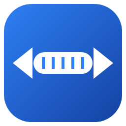
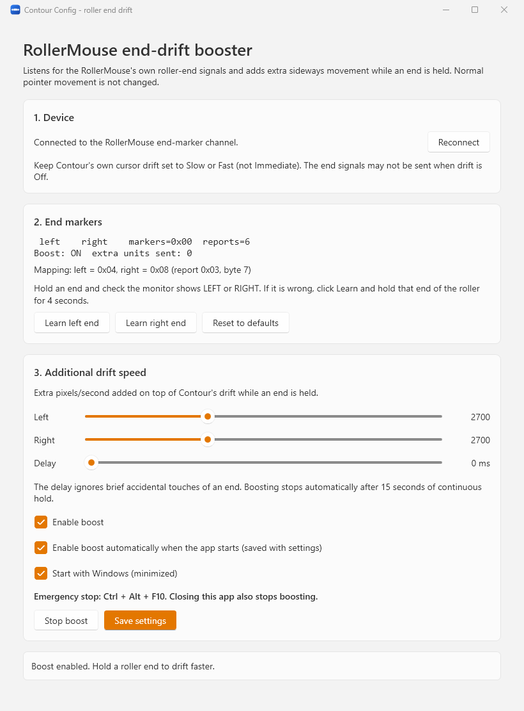
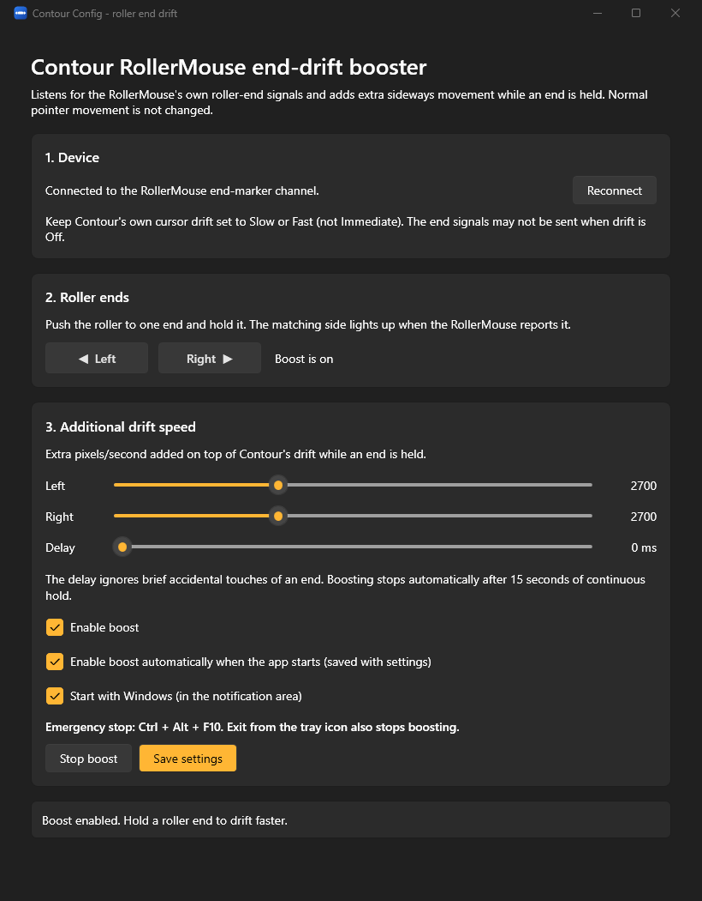

<p align="center">
  
</p>

<h1 align="center">Contour Config</h1>

<p align="center">
  Faster, safer end-of-roller cursor drift for the <b>Contour RollerMouse Red Plus Wireless</b> on Windows.
</p>

---

## Why?

The RollerMouse has a feature where the cursor keeps drifting when you push the roller bar all the way to its left or right end. Contour's own software offers only four settings:

| Setting   | Problem                                                                          |
|-----------|----------------------------------------------------------------------------------|
| Off       | No drift.                                                                        |
| Slow/Fast | Even *Fast* is too slow on large or multiple monitors.                           |
| Immediate | The cursor jumps away whenever you accidentally touch an end.                    |

The drift speed is decided by the mouse firmware, so there's no setting to tweak. **Contour Config** works around this. It listens for the mouse's own *"roller is at an end"* signal and adds extra sideways speed for as long as you hold the end. It can also wait for a short, configurable delay first, so accidental touches don't move the cursor.

## Screenshots

| Light mode | Dark mode |
|:----------:|:---------:|
|  |  |

The app follows the Windows light/dark setting automatically.

## Features

- ⚡ **Adjustable drift boost:** 0–8000 extra pixels per second, set separately for the left and right ends.
- ⏱️ **Activation delay:** 0–2000 ms, so brief accidental touches are ignored.
- 🎯 **Uses the hardware end signal:** normal pointer movement is never changed.
- 🧠 **Learn mode:** detects which signal belongs to which end if your device differs.
- 🚀 **Start with Windows:** starts quietly in the notification area at sign-in and turns the boost on automatically.
- 🖱️ **Lives in the notification area:** no taskbar button. Left-click the tray icon to open the window, right-click for *Open*, *Boost enabled* and *Exit*.
- 🔌 **Auto-reconnect:** handles the mouse sleeping, Bluetooth reconnects, lock/unlock and sleep/resume.
- 🛑 **Emergency stop:** <kbd>Ctrl</kbd>+<kbd>Alt</kbd>+<kbd>F10</kbd> stops the boost.
- 🌗 **Light and dark mode:** follows the Windows theme.
- 🔒 **No admin rights or drivers needed:** the app never writes to the mouse.

## Requirements

- Windows 10 or 11
- Contour RollerMouse Red Plus Wireless, connected over **Bluetooth** (the USB receiver is untested)
- Nothing else. The installer includes .NET. Building from source needs the [.NET 10 SDK](https://dotnet.microsoft.com/download/dotnet/10.0).

## Install

1. Download **`ContourConfigSetup-<version>.msi`** from the [latest release](https://github.com/pfjordside/contour-config/releases/latest).
2. Run it. If Windows SmartScreen warns about an unknown publisher (the installer isn't code-signed), choose *More info › Run anyway*.
3. Click through the wizard:
   - It installs for your user only into `%LOCALAPPDATA%\Programs\ContourConfig`. You can change the folder. No admin rights are needed.
   - It adds a **Contour Config** Start menu shortcut.
   - It offers to launch the app when it finishes.

To **update**, download and run a newer MSI. It closes the running app and replaces the old version. Your settings and *Start with Windows* choice are kept.

To **uninstall**, use *Settings › Apps › Installed apps › Contour Config*. This closes the app and removes its *Start with Windows* entry. Your settings in `%LOCALAPPDATA%\ContourConfig` are left behind. Delete that folder to remove them too.

For a silent install, run `msiexec /i ContourConfigSetup-<version>.msi /qn`.

<details>
<summary>Build the installer yourself</summary>

```powershell
git clone https://github.com/pfjordside/contour-config.git
cd contour-config
dotnet build .\installer -c Release
```

The MSI is written to `installer\bin\x64\Release\ContourConfigSetup.msi`.
</details>

## How to use

1. **Set Contour's drift to Slow or Fast.** In Contour's own config tool, choose *Slow* or *Fast*, not *Immediate*. The mouse may not send the end signal when drift is *Off*.
   (If you don't want Contour's software running, you can uninstall it afterwards. The setting is stored in the mouse.)
2. **Check the connection.** Section **1. Device** should say *Connected to the RollerMouse end-marker channel*. If the mouse is asleep, move it and the app reconnects within a few seconds.
3. **Check the end markers.** Push the roller to the left end and hold it. The monitor in **2. End markers** should show `[LEFT]`. Do the same for the right end, which should show `[RIGHT]`.
   If an end shows the wrong side or nothing, click **Learn left end** or **Learn right end** and hold that end for 4 seconds.
4. **Tune the speed.** In **3. Additional drift speed**:
   - **Left / Right:** the extra pixels per second, added on top of Contour's own drift. Start around 1500 and adjust to taste.
   - **Delay:** how long an end must be held before the boost starts. Use 0 ms for instant boost, or 200–400 ms if you often touch the ends by accident.
5. **Enable boost** and try it out. Changes to the sliders apply immediately.
6. Optionally tick **Enable boost automatically when the app starts** and **Start with Windows (in the notification area)**.
7. Click **Save settings**.

### The tray icon

The app runs in the notification area (system tray), not on the taskbar. Closing or minimizing the window hides it to the tray, and the boost keeps working. Left-click the icon or start the app again from the Start menu to show the window. Right-click the icon to turn the boost on or off or to **Exit**.

On Windows 11 new icons first appear in the hidden-icons flyout (the **^** arrow). Drag the icon onto the taskbar corner, or turn it on in *Settings › Personalization › Taskbar › Other system tray icons*, to keep it visible.

### Stopping the boost

Press <kbd>Ctrl</kbd>+<kbd>Alt</kbd>+<kbd>F10</kbd>, click **Stop boost**, untick **Enable boost** (in the window or the tray menu), or choose **Exit** in the tray menu. As a safety measure, the boost also stops by itself after 15 seconds of continuous hold, on disconnect, and when the PC locks or sleeps. If *Enable boost automatically* is saved, it comes back after unlock or resume.

### Start with Windows

**Start with Windows (in the notification area)** adds a per-user `ContourConfig` entry under
`HKCU\Software\Microsoft\Windows\CurrentVersion\Run` that runs the app with `--startup`. Untick it to remove the entry. Always enable it from the installed copy, not from a development build.

## Troubleshooting

| Symptom                                    | Try                                                                                   |
|--------------------------------------------|---------------------------------------------------------------------------------------|
| *RollerMouse not found*                    | Move the mouse to wake it and wait a few seconds. Check it's paired in Bluetooth settings. |
| Monitor never shows `[LEFT]` / `[RIGHT]`   | Make sure Contour's drift is *Slow* or *Fast*, then use **Learn**.                    |
| Boost doesn't work in some windows         | Windows blocks injected input into apps running as administrator.                     |
| *Could not register Ctrl+Alt+F10*          | Another app uses that shortcut. Boost stays disabled without an emergency stop.        |
| Can't find the window                      | It's hidden in the notification area. Click the tray icon (check the **^** flyout), or start Contour Config again from the Start menu. |

## How it works

The RollerMouse exposes several HID collections over Bluetooth (`VID 0B33`, `PID 1006`). Its consumer-control collection sends input report `0x03` whenever its state changes. **Byte 7** of that report is a bitfield:

| Bit    | Meaning                     |
|--------|-----------------------------|
| `0x04` | Left end of the roller held |
| `0x08` | Right end of the roller held|
| `0x01` | Unknown short pulses (ignored) |

The app reads these reports alongside Windows, without exclusive access. While an end bit is set for longer than the configured delay, a background thread injects extra relative horizontal movement with `SendInput` every few milliseconds. Each step is capped, so a stalled timer can never cause a big jump. Contour's own firmware drift keeps running underneath, and the boost stops as soon as the bit clears.

Contour's official software can only switch the firmware between Off, Slow, Fast and Immediate. No finer speed parameter is known, so this app doesn't send anything to the mouse.

## Settings

Settings are stored in `%LOCALAPPDATA%\ContourConfig\settings.json`:

```json
{
  "Version": 2,
  "Options": {
    "LeftAdditionalSpeed": 2700,
    "RightAdditionalSpeed": 2700,
    "ActivationDelayMilliseconds": 0,
    "MaximumBoostMilliseconds": 15000
  },
  "Markers": { "LeftMask": 4, "RightMask": 8 },
  "EnableBoostOnStart": true
}
```

Invalid files show an error and are never applied silently. Version 1 files from the early prototype are migrated: their speeds are kept.

## Development

```powershell
dotnet build .\ContourConfig.slnx
dotnet test .\tests\ContourConfig.Core.Tests.Unit
dotnet run --project .\src\ContourConfig.App
dotnet build .\installer -c Release   # self-contained publish + MSI (WiX v5), not part of the solution
```

To publish a release, push a version tag, for example `git tag v1.0.0; git push origin v1.0.0`. The [Release workflow](.github/workflows/release.yml) runs the tests, builds `ContourConfigSetup-1.0.0.msi` with that version and attaches it to a new GitHub Release. Use a higher version for every release so the MSI upgrades older installs.

| Project                          | Contents                                                                                      |
|----------------------------------|-----------------------------------------------------------------------------------------------|
| `src/ContourConfig.Core`         | Marker decoding (`EndMarkerMap`), time-based boosting (`EndDriftBooster`), `MarkerLearner`, settings |
| `src/ContourConfig.App`          | WPF UI (Fluent theme), HID reader (`RollerMouseHid`), `SendInput`, tray icon, startup        |
| `tests/ContourConfig.Core.Tests.Unit` | xUnit tests for the core logic                                                           |
| `installer`                      | WiX v5 per-user MSI with setup wizard (`Package.wxs`)                                         |

The build uses .NET 10 with nullable reference types, all analyzers enabled and warnings treated as errors. There are no third-party runtime packages.

> ⚠️ Don't send speculative HID feature or output reports to the mouse. Their meaning and side effects are unverified.

## Disclaimer

This is an unofficial hobby project and is not affiliated with or endorsed by Contour Design. Use it at your own risk.
